# Multimodel Cardiac

An offline cardiology report assistant. Upload a cardiology report PDF, and the app extracts the key fields, predicts coronary artery disease (CAD) risk per vessel, and lets you ask questions about the assessment in a chat. Everything runs on your own machine: no internet connection or cloud API is needed once the setup is done.

> **Disclaimer:** This is a research and learning project. It is not a medical device and must not be used for diagnosis or treatment decisions.

## Download

[](https://drive.google.com/file/d/1U9qJdiwolxpVdYi2VhvHLHxJEXY3A-M6/view?usp=sharing)

The download runs entirely on your machine. You still need [Ollama](https://ollama.com) installed with the `llama3.1:8b` model pulled (see [Getting started](#getting-started)).

## What it does

1. **Upload:** You upload a cardiology report PDF.
2. **Extract:** The text is pulled from the PDF and sent to a local Ollama model (`llama3.1:8b`), which returns the report fields as structured data.
3. **Predict:** The fields are turned into a feature vector, and an ONNX model predicts **LAD, LCX, RCA** and **CAD**.
4. **Summarise:** The predictions are passed to Ollama to produce a plain-language summary.
5. **Store:** The report, predictions and summary are saved in a local H2 database.
6. **Chat:** You can ask follow-up questions about an assessment. Answers stream into the UI token by token.

## Architecture

```mermaid
flowchart LR
    subgraph OFFLINE["OFFLINE: everything runs on localhost, no internet or cloud APIs"]
        direction LR
        subgraph CLIENT["Client (browser)"]
            direction TB
            U([User])
            subgraph UI["React UI (cardioscope)"]
                direction TB
                UP["Upload page<br/>PDF drop zone"]
                RES["Results view<br/>LAD / LCX / RCA / CAD"]
                CH["Chat panel<br/>streamed answers"]
            end
            API["API client<br/>fetch + auth + SSE reader"]
        end
        subgraph BACKEND["Spring Boot Backend"]
            direction TB
            SEC["Basic Auth<br/>Security Filter"]
            PDFC["POST /PDF"]
            CHATC["POST /chat"]
            PARSE["PDF Text<br/>Extractor"]
            EXTRACT["Field Extraction<br/>Service"]
            PRED["Prediction<br/>Service"]
            CHATS["Chat Service<br/>(streaming)"]
            REPO["JPA<br/>Repositories"]
        end
        subgraph AI["Local AI / ML"]
            direction TB
            OLL["Ollama (local)<br/>llama3.1:8b"]
            ONNX["ONNX Runtime<br/>LAD / LCX / RCA / CAD"]
        end
        subgraph DATA["Local Storage"]
            H2[("H2 File<br/>Database")]
        end
    end

    U --> UP
    U --> RES
    U --> CH
    UP --> API
    RES --> API
    CH --> API
    API <-->|"HTTP + auth"| SEC
    SEC --> PDFC
    SEC --> CHATC
    PDFC -->|"PDF file"| PARSE
    PARSE -->|"raw text"| EXTRACT
    EXTRACT <-->|"extract fields"| OLL
    EXTRACT -->|"features"| PRED
    PRED <-->|"inference"| ONNX
    PRED <-->|"predictions → summary"| OLL
    PRED -->|"save"| REPO
    REPO <--> H2
    CHATC --> CHATS
    CHATS -->|"load assessment"| REPO
    CHATS <-->|"token stream (SSE)"| OLL

    classDef client fill:#4F9DFF,stroke:#1F5FBF,color:#fff,stroke-width:2px
    classDef ui fill:#6C7BFF,stroke:#3E49C2,color:#fff,stroke-width:2px
    classDef security fill:#FF6B6B,stroke:#B83A3A,color:#fff,stroke-width:2px
    classDef controller fill:#FFB347,stroke:#C77F10,color:#000,stroke-width:2px
    classDef service fill:#4CC38A,stroke:#2A8A5C,color:#fff,stroke-width:2px
    classDef ai fill:#B07CFF,stroke:#7A45CC,color:#fff,stroke-width:2px
    classDef data fill:#37C5D9,stroke:#1D8A99,color:#fff,stroke-width:2px
    class U,API client
    class UP,RES,CH ui
    class SEC security
    class PDFC,CHATC controller
    class PARSE,EXTRACT,PRED,CHATS,REPO service
    class OLL,ONNX ai
    class H2 data
    style OFFLINE fill:none,stroke:#2A8A5C,stroke-dasharray:8 4
    style CLIENT fill:none,stroke:#888,stroke-dasharray:4 4
    style UI fill:none,stroke:#3E49C2,stroke-dasharray:4 4
    style BACKEND fill:none,stroke:#888,stroke-dasharray:4 4
    style AI fill:none,stroke:#888,stroke-dasharray:4 4
    style DATA fill:none,stroke:#888,stroke-dasharray:4 4
```



A downloadable, colour-coded version of this diagram is in `multimodel_system_design.html` (works offline).

## Tech stack

| Layer | Technology |
|---|---|
| Frontend | React, Vite |
| Backend | Spring Boot, Java 21, Gradle |
| Security | Spring Security (HTTP Basic Auth) |
| LLM | Ollama, `llama3.1:8b` |
| Prediction | ONNX Runtime |
| Database | H2 (file mode) |

## Prerequisites

- Java 21
- Node.js 18 or newer and npm
- [Ollama](https://ollama.com) installed and running
- The ONNX model file (see [Configuration](#configuration))

## Getting started

### 1. Pull the Ollama model (one time, needs internet)

```bash
ollama pull llama3.1:8b
```

After this, Ollama serves the model locally (default `http://localhost:11434`) and no internet is needed.

### 2. Run the backend

```bash
git clone https://github.com/Devil-Gaming-Studios/Multimodel_Cardiac1.git
cd Multimodel_Cardiac1
./gradlew bootRun
```

On Windows use `gradlew.bat bootRun`.

### 3. Run the frontend

```bash
cd mm-frontend
npm install
npm run dev
```

Open the URL that Vite prints (usually `http://localhost:5173`).

## Configuration

Settings live in `src/main/resources/application.properties`.

| Setting | Value | What it does |
|---|---|---|
| `server.address` / `server.port` | `127.0.0.1` / `8080` | The backend only accepts connections from the same machine. |
| `spring.datasource.url` | `jdbc:h2:file:${user.home}/.multimodel/multimodel;CIPHER=AES` | AES-encrypted H2 database stored in your home folder. No database server needed. |
| `spring.datasource.password` | `${DB_FILE_PASSWORD:...} ${DB_USER_PASSWORD:...}` | H2 takes two passwords separated by a space: the file encryption password, then the user password. |
| `spring.servlet.multipart.max-file-size` | `20MB` | Largest PDF you can upload. |
| `ollama.url` | `http://localhost:11434` | Where the backend finds Ollama. |
| `ollama.model` | `llama3.1:8b` | Model used for field extraction, summaries and chat. |

**Set your own database passwords before the first run.** The defaults in the file are placeholders:

```bash
# macOS / Linux
export DB_FILE_PASSWORD="your-file-password"
export DB_USER_PASSWORD="your-user-password"

# Windows (PowerShell)
$env:DB_FILE_PASSWORD="your-file-password"
$env:DB_USER_PASSWORD="your-user-password"
```

H2 fixes these passwords when it creates the database file, so use the same values on every later run. If you lose them, the file can't be opened.

The ONNX model path and the Basic Auth credentials are not set in this file, so document where they live in your code.

### Debug settings

These lines are useful while developing but should be removed for a release, because they make logs very noisy and put stack traces in error responses:

```properties
logging.level.org.springframework.security=DEBUG
logging.level.org.springframework.web=DEBUG
server.error.include-stacktrace=always
```

## API

All endpoints require HTTP Basic Auth.

| Method | Endpoint | Description |
|---|---|---|
| `POST` | `/PDF` | Upload a cardiology report PDF (multipart). Returns the extracted fields and predictions. |
| `POST` | `/chat` | Ask a question about one assessment. The answer streams back as server-sent events. |

Example upload:

```bash
curl -u USER:PASSWORD -F "file=@report.pdf" http://localhost:8080/PDF
```

Replace `USER:PASSWORD` and the port with the values from your configuration.

## Running fully offline

- Pull the Ollama model once while online, then stay offline.
- Keep the ONNX model file inside the project or in a local folder.
- For production, run `npm run build` and serve the `dist` folder from Spring Boot's static resources instead of using the Vite dev server.
- Don't load fonts or scripts from a CDN in the frontend.
- To build on an air-gapped machine, copy the Gradle cache and `node_modules` over from a machine that has internet.

## Troubleshooting

- **`POST /PDF` returns an error page and nothing is logged:** check that Ollama is running and the model name matches the configuration, and look at the backend log level.
- **Chat answers arrive all at once:** the endpoint must return a streaming response (SSE), and the frontend must read the response body as a stream instead of waiting for the full body.
- **Slow first response:** Ollama loads the model into memory on the first request. Later requests are faster.

## Project structure

```
Multimodel_Cardiac1/
├── src/                 Spring Boot backend
├── mm-frontend/         React + Vite frontend (cardioscope)
├── build.gradle         Gradle build
└── README.md
```

Folder names are my best guess. Adjust them to match the repo.

## License

Add your license here.
